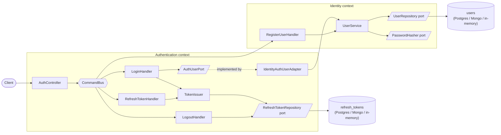

# Auth Server

[](https://github.com/tsatsarisg/auth-server/actions/workflows/ci.yml)

**Production-reference authentication server built with NestJS, TypeScript, and clean architecture.**

> Source-available for viewing and local evaluation. See [License](#license) for terms.

---

## Overview

Auth Server is a production-grade authentication service demonstrating clean architecture, CQRS, and domain-driven design principles in a NestJS application. It implements JWT-based authentication with refresh token rotation, multi-database support, and defense-in-depth security practices.

The architecture follows a vertical slice approach inspired by Greg Young's CQRS and domain modeling patterns. Each use case (register, login, refresh, logout) is an isolated vertical slice with its own command, handler, and domain events. Cross-cutting concerns like encryption, persistence, and logging are separated through ports and adapters, keeping the domain logic free of infrastructure dependencies.

The codebase is organized into two bounded contexts -- **Identity** (user registration, password hashing, user persistence) and **Authentication** (token issuance, rotation, revocation, session lifecycle). The dependency between them is strictly one-directional: Authentication consumes Identity through a narrow port (`AuthUserPort`) implemented by a translating adapter over Identity's public surface (`identity/index.ts`). Identity has no knowledge of Authentication, and the boundary is machine-enforced with Oxlint import rules.

---

## Architecture



The dependency between contexts runs one way: Authentication → Identity, through `AuthUserPort` and Identity's public surface only. Key decisions are recorded as ADRs in [`docs/adr/`](./docs/adr/): [dual-database adapters](./docs/adr/0001-dual-database-adapters.md), [CQRS with vertical slices](./docs/adr/0002-cqrs-vertical-slices.md), and [encrypting password hashes at rest](./docs/adr/0003-encrypting-password-hashes-at-rest.md).

### Vertical Slice Organization

Each feature is a self-contained slice with its own command/query, handler, and domain events. Shared infrastructure (controllers, services, adapters) lives in a `shared/` directory within each bounded context.

### Bounded Contexts

- **Identity** -- Owns the user aggregate, email/password value objects, password hashing strategy, user persistence, and the register use case.
- **Authentication** -- Owns token issuance, refresh token rotation, reuse detection, logout, scheduled cleanup, and refresh-token persistence (its own table in PostgreSQL, its own collection in MongoDB).

### Patterns

- **CQRS** -- Commands mutate state (register, login, refresh, logout), dispatched via NestJS `CommandBus` with compile-time-typed results.
- **Ports and Adapters** -- Domain logic depends on port interfaces (`UserRepository`, `PasswordHasher`, `RefreshTokenRepository`). Concrete adapters (Postgres, MongoDB) are injected at the module level.
- **Domain Events** -- Each use case emits domain events (`UserRegistered`, `LoginSucceeded`, `RefreshTokenReused`, `UserLoggedOut`) consumed by audit handlers for structured logging.
- **Result Type** -- Business operations return `Result<T, E>` (via neverthrow) instead of throwing exceptions, keeping error handling explicit in the domain layer.
- **Enforced boundaries** -- Oxlint `no-restricted-imports` rules make the context dependency direction checkable in CI: Identity may never import Authentication; Authentication may import Identity only via its public surface.

## Features

- JWT authentication with access tokens (15 min) and refresh token rotation (7 day)
- Refresh token reuse detection -- revokes all sessions on replay attack
- Multi-database support: PostgreSQL (Drizzle ORM) and MongoDB (Mongoose), switchable via environment variable
- AES-256-GCM encryption at rest for stored password hashes
- Scrypt password hashing with versioned cost parameters and timing-safe comparison
- Per-endpoint rate limiting (e.g., 3 req/min for registration, 5 for login)
- HttpOnly, Secure, SameSite=Strict cookie-based refresh tokens
- Audit logging via domain events (register, login, refresh reuse, logout)
- Health check endpoint with database connectivity verification
- OpenAPI / Swagger documentation at `/docs`
- Scheduled token cleanup (daily purge of expired and revoked tokens)
- Correlation IDs via `X-Request-Id` header propagation (Pino)
- Helmet security headers
- Configurable CORS with origin allowlist
- Zod schema validation at the HTTP boundary
- Docker support with dev and production multi-stage builds
- Request body size limit (16 KB) to mitigate hash-DoS attacks
- Trust proxy configuration for deployment behind reverse proxies

---

## Tech Stack

| Category        | Technology                                 |
| --------------- | ------------------------------------------ |
| Runtime         | Node.js 24 LTS                             |
| Framework       | NestJS 12                                  |
| Language        | TypeScript 6.0.3 (strict mode)             |
| Databases       | PostgreSQL 17, MongoDB 8                   |
| ORM             | Drizzle ORM (Postgres), Mongoose (MongoDB) |
| Auth            | JWT with HS256, separate signing keys      |
| Validation      | Zod                                        |
| Logging         | Pino (structured JSON, pino-pretty dev)    |
| API Docs        | Swagger / OpenAPI 3.0                      |
| Containers      | Docker, Docker Compose                     |
| Package Manager | pnpm 12.14.0                               |
| Linting         | Oxlint (type-aware), Prettier              |
| Testing         | Jest, Supertest                            |

---

## Getting Started

### Prerequisites

- Node.js 24.22.1 (LTS)
- pnpm 12.14.0 (integrity-pinned)
- Docker and Docker Compose

### Setup

1. **Clone the repository**

   ```bash
   git clone <repository-url>
   cd auth-server
   ```

2. **Configure environment variables**

   ```bash
   cp infra/envs/.env.dev.example infra/envs/.env.dev
   ```

   Edit `infra/envs/.env.dev` and fill in your secrets. At minimum, generate the required keys:

   ```bash
   # Generate JWT secrets (32+ characters each)
   openssl rand -hex 32

   # Generate AES-256 encryption key (exactly 32 bytes, base64-encoded)
   openssl rand -base64 32
   ```

3. **Start infrastructure**

   ```bash
   docker compose -f infra/docker/docker-compose.dev.yml up -d mongo postgres
   ```

4. **Install dependencies**

   ```bash
   pnpm install
   ```

5. **Run database migrations** (PostgreSQL only)

   ```bash
   pnpm --filter auth-server run db:migrate
   ```

6. **Start the development server**

   ```bash
   pnpm --filter auth-server run start:dev
   ```

7. **Verify**

   - Swagger UI: [http://localhost:3000/docs](http://localhost:3000/docs)
   - Health check: [http://localhost:3000/health](http://localhost:3000/health)

### Full-Stack Dev (Docker)

To run everything in Docker (databases + application with hot reload):

```bash
docker compose -f infra/docker/docker-compose.dev.yml up
```

---

## Testing

Both suites run against in-memory implementations of the repository ports — the same seam the Postgres and Mongo adapters plug into — so no database is needed.

- **Unit tests** (`pnpm --filter auth-server run test`) cover the security-critical seams: refresh rotation with reuse detection and the concurrent double-spend race, typed token claims (wrong-type and missing-claim rejection), scrypt hashing including the legacy format, AES-GCM encryption and tamper detection, email normalization, credential verification with timing equalization, and the `Result` → HTTP error mapping.
- **End-to-end tests** (`pnpm --filter auth-server run test:e2e`) drive the full HTTP lifecycle: register → duplicate conflict → login (case-insensitive) → refresh rotation → replay detection → family-wide revocation → logout with cookie clearing.

CI runs `pnpm check` and builds both Docker images on every push and pull request. Use `corepack enable` and `corepack install` to activate the exact pnpm pin. The workspace keeps exact direct versions, a seven-day release quarantine, blocked dependency lifecycle scripts, registry-only transitive dependencies and provenance downgrade protection. See [the tooling review](docs/tooling-security-review.md) for remaining advisories and upgrade decisions.

---

## Docker

### Development

```bash
docker compose -f infra/docker/docker-compose.dev.yml up
```

Includes hot reload via volume mounts. Application runs on port 3000.

### Production

With PostgreSQL:

```bash
docker compose -f infra/docker/docker-compose.prod.yml --profile postgres up -d
```

With MongoDB:

```bash
docker compose -f infra/docker/docker-compose.prod.yml --profile mongo up -d
```

Production builds use multi-stage Dockerfiles for minimal image size.

---

## API Endpoints

| Method | Endpoint                | Description                          | Auth Required |
| ------ | ----------------------- | ------------------------------------ | ------------- |
| POST   | `/api/v1/auth/register` | Register a new user                  | No            |
| POST   | `/api/v1/auth/login`    | Authenticate and receive tokens      | No            |
| POST   | `/api/v1/auth/refresh`  | Rotate refresh token, get new access | Cookie        |
| POST   | `/api/v1/auth/logout`   | Revoke all refresh tokens            | Bearer token  |
| GET    | `/health`               | Health check with DB status          | No            |
| GET    | `/docs`                 | Swagger UI                           | No            |

---

## Project Scripts

Run `pnpm check` from the repository root for typecheck, type-aware Oxlint, formatting, architecture rules, unit/e2e tests and the build. Shared tooling lives at the workspace root; application-specific scripts also support `pnpm --filter auth-server run <script>`.

| Script         | Description                             |
| -------------- | --------------------------------------- |
| `start:dev`    | Start with hot reload (watch mode)      |
| `start:debug`  | Start with debugger attached            |
| `start:prod`   | Run compiled production build           |
| `build`        | Compile TypeScript to `dist/`           |
| `lint`         | Run type-aware Oxlint                   |
| `lint:fix`     | Run Oxlint with auto-fix                |
| `format`       | Format code with Prettier               |
| `format:check` | Check formatting without writing        |
| `typecheck`    | Run TypeScript type checking            |
| `test`         | Run unit tests                          |
| `test:watch`   | Run tests in watch mode                 |
| `test:cov`     | Run tests with coverage report          |
| `test:e2e`     | Run end-to-end tests                    |
| `db:generate`  | Generate Drizzle migration files        |
| `db:migrate`   | Run Drizzle migrations                  |
| `db:push`      | Push schema changes directly (dev only) |
| `db:studio`    | Open Drizzle Studio GUI                 |
| `audit`        | Run security audit on dependencies      |
| `deps:check`   | Check for outdated dependencies         |

Root-level convenience scripts:

| Script     | Description                             |
| ---------- | --------------------------------------- |
| `dev`      | Start full dev stack via Docker Compose |
| `dev:down` | Tear down dev Docker Compose stack      |

---

## Environment Variables

| Variable                | Description                                           | Required                    |
| ----------------------- | ----------------------------------------------------- | --------------------------- |
| `PORT`                  | Server port                                           | Yes                         |
| `NODE_ENV`              | Environment (`development`, `production`)             | Yes                         |
| `DB_PROVIDER`           | Database backend (`postgres` or `mongo`)              | Yes (default: `postgres`)   |
| `POSTGRES_URI`          | PostgreSQL connection string                          | When `DB_PROVIDER=postgres` |
| `MONGO_URI`             | MongoDB connection string                             | When `DB_PROVIDER=mongo`    |
| `JWT_SECRET`            | Access token signing key (min 32 characters)          | Yes                         |
| `JWT_REFRESH_SECRET`    | Refresh token signing key (min 32 characters)         | Yes                         |
| `ENCRYPTION_KEY_BASE64` | AES-256 key for encryption at rest (base64, 32 bytes) | Yes                         |
| `ALLOWED_ORIGINS`       | Comma-separated CORS origins                          | No                          |
| `TRUST_PROXY`           | Proxy hop count or trusted IPs for `X-Forwarded-*`    | No                          |

---

## License

This project is **proprietary and source-available**. You may view the code, and prospective employers or clients may clone, build, and run it locally to evaluate the author's work. Any other use, copying, modification, or distribution is not permitted. See the [LICENSE](./LICENSE) file for full terms.

Copyright (c) 2025-present George. All rights reserved.
